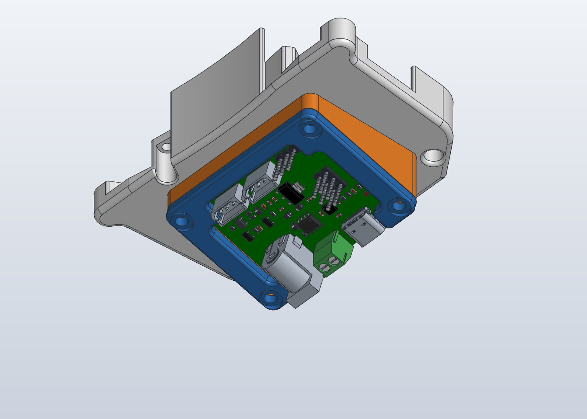

# Waveshare servo controller mount

Pinc'Open has no place for the Feetech STS3215's controller board. This mount holds a [Waveshare Bus Servo Adapter (A)](https://www.waveshare.com/wiki/Bus_Servo_Adapter_(A)) on the outer face of `Bottom_Plate`, tilted 15° so the DC power plug clears the arm.

## Parts

| File | What it is |
|---|---|
| [`cad/stl/Bottom_Plate_Controller.stl`](../cad/stl/Bottom_Plate_Controller.stl) | `Bottom_Plate` with 4× Ø4.0 through holes for M3 heat inserts. Replaces `Bottom_Plate` |
| [`cad/stl/Controller_Riser.stl`](../cad/stl/Controller_Riser.stl) | 15° wedge the board sits on, 39 × 56 mm footprint |
| [`cad/stl/Controller_Cover.stl`](../cad/stl/Controller_Cover.stl) | U-shaped frame that clamps the board's 4 corners |
| `cad/step/*.step` | Editable STEP of each part (same coordinates as the STLs) |
| [`cad/controller_mount/build_controller_mount.py`](../cad/controller_mount/build_controller_mount.py) | Script that builds all three from the dimensions below |

The other Pinc'Open parts don't change. The holes are the only change to `Bottom_Plate`, so it still fits a gripper without the controller.

### Hardware

- 1× Waveshare Bus Servo Adapter (A), 42 × 33 mm
- 4× M3 heat inserts, **4 mm long**
- 2× M3×12 socket head screws (jaw side)
- 2× M3×20 socket head screws (arm side)

## Design

All coordinates are in `Bottom_Plate`'s frame: the outer face is Z = −13, +X points to the jaws, and the arm interface is at X = −53.5.

- **Orientation**: the board's connector edge (DC jack, screw terminal, USB-C) faces the arm. That edge is raised, so the power plug leaves at 15° away from the plate. The servo headers, UART header, jumpers and power LED face up and stay open.
- **Riser**: a 3 mm pocket under the board clears the through-hole pins. The board rests on 4 pads, located by Ø2.1 pins in its Ø2.5 holes. Walls around it leave 0.5 mm per side.
- **Cover**: it presses only on the 4 corners, where the board has no parts. The riser beside the board is 0.2 mm lower than the board top, so the screws clamp the board and not the riser. Each screw head sits on a flat Ø6.2 seat.
- **Screws**: the riser and board are held only by the cover screws, which go into the inserts in the plate. The inserts sit at (−7.5, ±24.5) and (−38.5, ±24.5), clear of the cam pocket and the existing holes.
- **Insert holes**: the floor there is 4 mm thick, so the Ø4.0 holes go through, and a 4 mm insert ends flush on both faces. The screws engage 3 mm, so their tips stay inside the floor. Nothing above the floor is solid at those points (the gripper's inner cavity), so don't use a longer insert.

The board model used to check clearances is Waveshare's official STEP (wiki page above). The riser, cover and plate were checked against it and against each other with no interference. The board is not included here.

## Print

- **Material**: PETG or PLA, 0.4 mm nozzle.
- **Orientation**: the STLs are in their assembled, tilted position, so lay each one on a face in the slicer (for example, "place on face" in PrusaSlicer).
  - **Riser**: the flat plate-side face goes on the bed.
  - **Cover**: the flat board-side face goes on the bed.
  - **Bottom_Plate_Controller**: as the original `Bottom_Plate`.

  None of them needs support.
- **Insert holes** are Ø4.0, the usual size for M3 inserts. Check your insert's datasheet; some 5 mm wide inserts want Ø4.2.

## Assemble

1. Press the 4 heat inserts into `Bottom_Plate_Controller` from the outer face, flush with it.
2. Put the riser on the outer face, its screw holes over the inserts, the tall end toward the arm.
3. Drop the board on the pins with the connector edge on the tall end.
4. Put the cover on and screw it down: M3×12 on the jaw side, M3×20 on the arm side.

## Not checked yet

- The parts have not been printed and fitted on a real gripper yet.
- The power plug's clearance to the arm (SO-ARM100 wrist or G1 adapter) was not modelled, so check it before you rely on the tilt.
